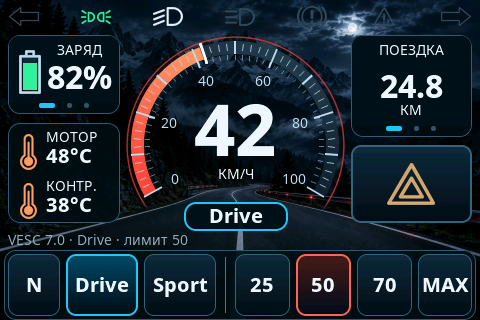

# eBike Display · ESP32-S3 + VESC

Прошивка сенсорного велодисплея **Guition JC3248W535** для электровелосипеда
с контроллером **Flipsky 75100 Pro V2.0 / VESC 7.0**.
Русский интерфейс, тёмная тема, управление с пульта на руле и настройка с телефона.




*Рендер настоящих виджетов LVGL. Значения на скриншоте — данные теста компоновки.
В прошивке используются показания VESC; без связи отображаются прочерки.*

## Возможности

- Крупная скорость и шкала, заряд, температуры двигателя и контроллера.
- Одометр, пробег и время текущей поездки. Новая поездка начинается при включении.
- Режимы **N / Drive / Sport**, ограничения **25 / 50 / 70 км/ч / MAX**.
- Безопасный режим: переключается в настройках или двойным нажатием M, скрывает 70 и MAX, при необходимости переключает лимит на 50. Доступные кнопки лимитов равномерно заполняют всю ширину своей группы.
- Управление ДХО, ближним и дальним светом, поворотниками, аварийкой и клаксоном.
- Резистивный пульт Z930: одиночное, двойное и длительное нажатия.
- Четыре экрана: приборы, настройки, диагностика и статистика поездки. Переключение свайпами влево/вправо.
- Карусели с точками: пробег / одометр / время; заряд / напряжение / мощность.
- График скорости за последнюю минуту и итоговые показатели поездки.
- Тайминги поворотников и кнопок, переворот экрана и тача на 180°.
- Сохранение настроек и пробега на SD, веб-интерфейс и обновление по Wi-Fi.
- Диагностика нагрузок через MCP23008 и ADS7830 на собственной плате.

## Оборудование

| Компонент | Поддерживаемый вариант |
|---|---|
| Дисплей | JC3248W535, ESP32-S3, Flash 16 МБ / PSRAM 8 МБ |
| Экран | AXS15231B, QSPI, 480 × 320 в горизонтальной ориентации |
| Контроллер | Flipsky 75100 Pro V2.0, прошивка VESC 7.0 |
| Связь с VESC | UART, **115200 бод, 8N1**, логика **3,3 В** |
| Пульт | Z930, пять резистивных кнопок + отдельные Power и M |
| Плата нагрузок | MCP23008 `0x20`, ADS7830 `0x48` |
| Хранение | SD-карта FAT32 |

Программный стек: Arduino ESP32 3.3.12 (PlatformIO Espressif32 8.0.0),
Arduino_GFX 1.6.9, LVGL 9.6.0, ArduinoJson 7.4.3. Платформа и библиотеки зафиксированы в [platformio.ini](platformio.ini).

## Сборка и прошивка

Нужны Python 3, USB-кабель с передачей данных и PlatformIO Core.
Скрипт `flash.sh` предназначен для Bash на macOS/Linux: найдёт установленный
PlatformIO или установит его в локальное окружение `.venv`.

```sh
./flash.sh
```

При нескольких USB-устройствах скрипт предложит выбрать порт. Можно указать его явно:

```sh
./flash.sh --port /dev/cu.usbmodemXXXX --monitor
./flash.sh --help
```

На Linux порт обычно имеет вид `/dev/ttyACM0`. Монитор работает на 115200 бод;
выход — `Ctrl+C`. Если дисплей не определяется: удерживать BOOT, нажать RST,
затем отпустить BOOT.

<details>
<summary>Сборка и запись вручную через PlatformIO</summary>

```sh
python3 -m venv .venv
.venv/bin/python -m pip install platformio==6.2.0
.venv/bin/pio run
.venv/bin/pio device list
.venv/bin/pio run -t upload --upload-port /dev/cu.usbmodemXXXX
.venv/bin/pio device monitor --port /dev/cu.usbmodemXXXX --baud 115200
```

На Windows используйте PlatformIO из VS Code или исполняемые файлы
из `.venv\Scripts` и порт вида `COM3`.

</details>

## Подключение

### Дисплей → Flipsky

| Контакт дисплея P1 | GPIO | Подключение Flipsky |
|---|---:|---|
| P1.1 · +5VIN | — | +5V при питании дисплея от контроллера |
| P1.2 · TX | 43 | RX |
| P1.3 · RX | 44 | TX |
| P1.4 · GND | — | GND |

TX и RX соединяются перекрёстно. Уровни UART — **3,3 В**.
При проверке с питанием дисплея от USB достаточно TX, RX и общего GND;
не соединяйте независимо питаемые выходы +5V.
Нумерацию и ориентацию разъёма сверяйте по маркировке конкретной платы.

### Пульт Z930

| Линия пульта | GPIO дисплея |
|---|---|
| Общая | GND |
| Резистивная | **GPIO6 + перемычка на GPIO9** |
| Power | GPIO7 |
| M | GPIO15 |

GPIO9 обеспечивает внутреннюю подтяжку, GPIO6 измеряет напряжение.
Внешний резистор не требуется. Таблица `key_mv` зависит от экземпляра пульта
и дисплея; для другой сборки потребуется проверка или калибровка уровней.
Одновременное нажатие резистивных кнопок не поддерживается.

Полная распиновка, плата нагрузок и проверка проводки:
[Подключение и проверка](docs/Подключение-и-проверка.md).

## Управление

| Кнопка / жест | Действие |
|---|---|
| Свет · одиночное нажатие | Выкл → ДХО → ближний; при дальнем — возврат к предыдущему свету |
| Свет · двойное нажатие | Сразу ДХО + ближний (`LIGHT1 + LIGHT2`) |
| Свет · удержание | Дальний: `LIGHT1 + LIGHT2 + LIGHT3` |
| Power · пока нажата | Моргание дальним |
| M · одиночное нажатие | N → Drive → Sport |
| M · двойное нажатие | Включить/выключить безопасный режим |
| Стрелки | Включить/выключить соответствующий поворотник |
| Нога / − | Включить/отменить круиз, если он разрешён |
| Клаксон · пока нажата | Звуковой сигнал |
| Иконка аварийки | Включить/выключить оба поворотника |

**N** временно обнуляет положительный масштаб моторного тока.
**Drive** и **Sport** восстанавливают исходный масштаб и задают разное время
нарастания аналогового газа: по умолчанию 1,0 и 0,15 с. Плавность PAS отдельно
этой настройкой не регулируется. Смена режима движения требует отпущенного газа.

Лимит скорости выбирается независимо от режима. **MAX возвращает исходный
предел VESC**, а не задаёт измеренную во время теста максимальную скорость.
Исходные ERPM и масштаб тяги сохраняются на SD с привязкой к ID контроллера,
чтобы временный лимит после перезапуска ESP не становился новым максимумом.
Если исходные значения ещё неизвестны, перезапустите Flipsky при включённом ESP.

При скорости от внешнего датчика или LispBM `override-speed` используется
измеренный коэффициент `speed_erpm_per_m_s`. Он связывает электрические обороты
со скоростью колеса и применяется к лимитам и круизу. Значение `0` использует
штатную геометрию VESC. Коэффициент конкретного велосипеда хранится на SD.

Во время применения режима отображается многоточие; после подтверждения —
название режима. При отказе или таймауте 5 секунд появляется `!` и причина.
Лимит подтверждается чтением фактических параметров контроллера.
Команды изменяют его оперативные настройки, без записи во Flash VESC.

### Карусели и страницы

На главном экране свайп внутри правой карточки или нажатие на её точки
переключает поездку, общий пробег и время работы. Выбор сохраняется на SD.
Левая карточка независимо переключает заряд, напряжение и мощность батареи.
Мощность вычисляется из напряжения и входного тока VESC; это не мощность на колесе.

Свайп вне карточек меняет страницу: приборы → настройки → диагностика → поездка.
График хранит последние 60 секунд скорости в RAM; разрывы связи оставляет пустыми.
Фон, растровые иконки и большие кнопки сохранены. Оформление использует нативные
виджеты LVGL 9 по мотивам [E-Bike Demo](https://lvgl.io/demos).
Постоянные декоративные анимации отключены, чтобы не занимать время опроса.

## Настройки, SD и Wi-Fi

На экране «Настройки» доступны тайминги кнопок и поворотников, переворот
изображения, переключатели **«Управление VESC»** и **«Круиз-контроль»**.
Числа меняются кнопками «−» и «+», без ползунков; список прокручивается.
Изменения действуют сразу; кнопка «Сохранить» записывает их на SD.
Переключение управления VESC и разрешения круиза доступно после остановки в N при свежей телеметрии.

| Параметр JSON | Начальное значение | Назначение |
|---|---|---|
| `motion_enabled` | `false` | Разрешает команды режимов и лимитов |
| `cruise_enabled` | `false` | Отдельно разрешает круиз |
| `blink_on_ms` / `blink_off_ms` | `450` / `450` | Фазы мигания поворотников |
| `hold_ms` | `2000` | Порог длительного нажатия |
| `double_ms` | `300` | Интервал двойного клика |
| `screen_flipped` | `false` | Переворот экрана и тача на 180° |
| `speed_erpm_per_m_s` | `0` | Калибровка ограничения по датчику колеса |

При первом запуске управление тягой и круиз выключены. Включить управление
можно на дисплее или в веб-интерфейсе. До этого показанный N не означает,
что ESP заблокировал штатную ручку газа контроллера.

Для доступа с телефона:

1. Подключитесь к сети **`Ebike-XXXXXX`**.
2. Найдите пароль на экране «Диагностика» или в USB-мониторе.
3. Откройте **http://192.168.4.1**; логин `admin`, пароль тот же.

Пример изменения настроек после остановки в N:

```sh
curl -u 'admin:ПАРОЛЬ_С_ЭКРАНА' \
  -H 'Content-Type: application/json' \
  -d '{"motion_enabled":true,"cruise_enabled":false}' \
  http://192.168.4.1/api/settings
```

На SD создаются `state-a.json` и `state-b.json` — чередующиеся снимки с CRC32,
а также `wifi-password.txt`. Сохраняются настройки, свет, безопасный режим,
общий пробег и архив поездки. Новая поездка начинается при включении,
её время учитывает всё время работы. Поворотники, клаксон и круиз не восстанавливаются;
управление запускается с N. Без SD используются начальные значения,
данные не сохраняются, пароль Wi-Fi меняется после перезапуска.

Для OTA загружайте **`firmware.bin`**. Требуются подтверждённый N и свежая
нулевая скорость. Первый запуск выполняется по USB с таблицей разделов проекта.

## Диагностика и тесты

Команда **`d`** в USB-мониторе возвращает JSON: свежесть связи, пакеты и ошибки CRC,
ERPM, скорость, подтверждения команд, коэффициент скорости, пульт, SD и нагрузки.
Строка JSON позволяет менять настройки по USB с проверкой допустимости записи.
Каждые 5 секунд выводятся показатели времени цикла, отрисовки и памяти `PERF`.
Команда `u` в N запускает разовый тест полной отрисовки страниц; основной цикл
на время теста занят, поэтому его запускают только на неподвижном стенде.

После установки зависимостей PlatformIO:

```sh
sh tools/test.sh
python3 tools/render_ui.py
```

Первый скрипт запускает тесты ядра, VESC, SD и резистивного пульта с ASan/UBSan;
нужен компилятор C++17. Второй собирает реальные виджеты LVGL для проверки
компоновки, свайпов, точек каруселей, кнопок настроек и поворота тача; нужны macOS, `cc`/`c++` и `sips`.

| Часть проекта | Состояние проверки |
|---|---|
| Дисплей, SD, Wi-Fi, UART 115200 | Проверены на устройстве |
| N, подтверждения режимов, восстановление исходных лимитов | Проверены на стенде с Flipsky 7.0 |
| Скорость от датчика колеса | Коэффициент измерен и сохранён; точность лимитов после калибровки ещё проверяется |
| Круиз | Реализован и проверен программными тестами; натурная проверка нужна |
| Собственная плата нагрузок | Программная реализация готова; проверка на плате нужна |

Круиз использует временный LispBM-обработчик с отменой по тормозу и таймауту
связи; нужен настроенный регулятор скорости VESC и тормоз на ADC2.
При обрыве UART интерфейс переходит в неподтверждённый N: это само по себе
не гарантирует доставку команды запрета тяги контроллеру.

## Редактирование в LVGL Pro

Все четыре экрана перенесены в [проект LVGL Pro](ebike_display/README.md):
главный, настройки, диагностика и статистика поездки. Откройте папку
`ebike_display`, затем `screens/app.xml`. Макеты находятся в `components/*_view.xml`.
После изменений сохраните XML и выполните **Export code only** (Cmd+E),
затем запустите `./flash.sh`. PlatformIO автоматически собирает этот экспорт;
расположение элементов больше не задаётся в `src/Ui.cpp`.

Прошивка и нативный симулятор используют LVGL **9.6.0**. Последний стабильный
LVGL Pro **2.0.5** предоставляет предпросмотр **9.5.0**, поэтому в
`project.xml` указана эта совместимая версия. Экспорт проверяется сборкой
и рендером на 9.6.0. Emscripten для **Export code only** не нужен.

## Структура проекта

| Путь | Содержимое |
|---|---|
| [src/](src/) | Протокол VESC, устройства, LVGL, SD, Wi-Fi и основной цикл |
| [ebike_display/](ebike_display/) | Полный редактируемый интерфейс LVGL Pro и экспорт для ESP32 |
| [include/](include/) | Модель состояния, GPIO, настройки и программа круиза |
| [boards/](boards/) | Описание платы для PlatformIO |
| [assets/](assets/) | Исходные фон и иконки, инструкции преобразования |
| [tests/](tests/) | Тесты и аппаратные заглушки |
| [tools/](tools/) | Проверки, рендер интерфейса, генерация ресурсов и упаковка |
| [docs/](docs/) | Подключение, принятые решения и результаты проверок |

Обновление библиотек, изменения интерфейса и свежие замеры: [миграция на LVGL 9](docs/Миграция-LVGL9.md).

Подробности: [проверки на дисплее](docs/Проверка-на-дисплее.md),
[программные проверки](docs/Проверка-прошивки.md),
[фон](assets/README.md), [иконки](assets/icons/README.md).
Лицензия шрифтов Noto Sans — [OFL](tools/fonts/OFL.txt).

Упаковка успешной сборки в окружении PlatformIO:

```sh
.venv/bin/python tools/package.py
```

Получаются `dist/firmware.bin` для OTA, `dist/first-flash.bin` для USB с адреса
`0x0` и `dist/manifest.json` с SHA256. Для первой записи предпочтителен
`pio run -t upload`, который выбирает адреса автоматически.
Бинарные сборки, логи, окружения и данные SD исключены из Git через `.gitignore`;
исходники, графические ресурсы и скриншоты остаются в репозитории.
